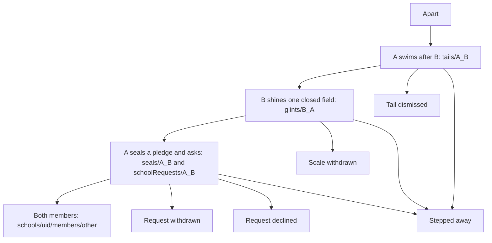
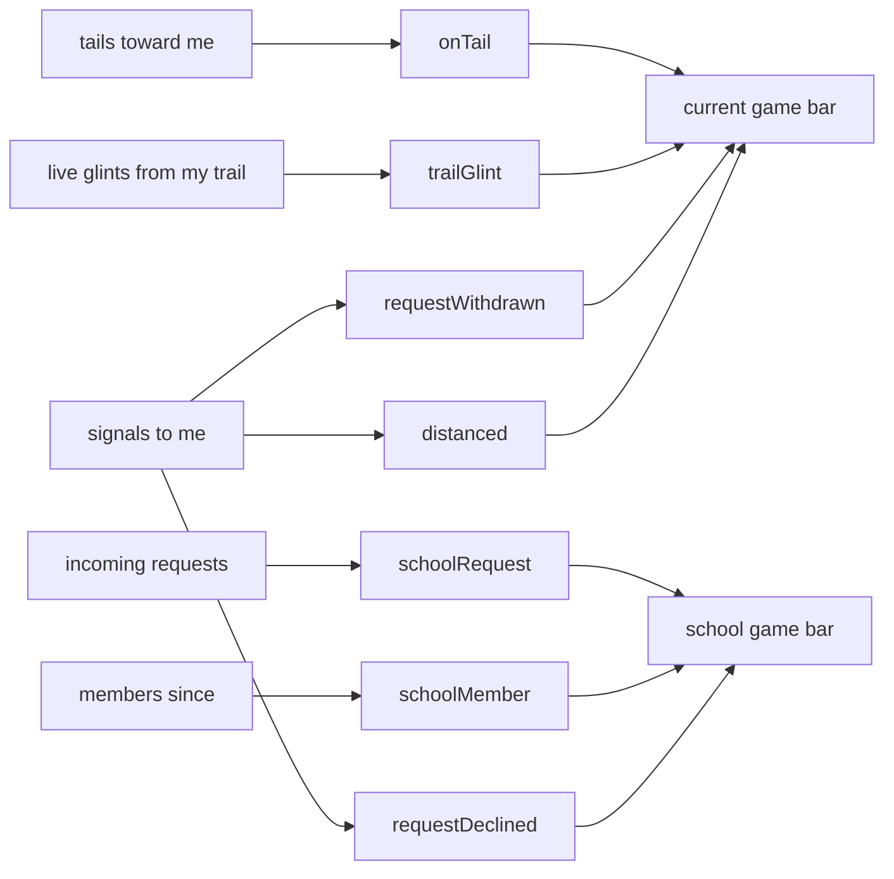

# Handshake

A school is a pair that finished three steps. Firestore rules enforce every
write. There are no Cloud Functions. Closed text leaves its owner only as the
one field that side chose to show.

A swims after B. Document ids are `{from}_{to}` auth uids.

## Pair

1. **Tail.** A creates `tails/{A}_{B}`. B sees A on current, under On my tail.
   Nothing closed is revealed.
2. **Glint.** While A still swims after B, B may shine one closed field
   (`glints/{B}_{A}`): a verbatim copy. A can read it for seven days, and only
   while the tail holds. The expiry is `expiresAt` on the document. Root may
   list every glint, so the root screen and the hourly tick read scales in one
   query. Closed texts of real fish stay unread.
3. **Request.** A answers with `schoolRequests/{A}_{B}` and a sealed pledge of
   one of A's own closed fields (`seals/{A}_{B}`). B reads the pledge only
   after accepting.
4. **School.** B accepts. Both `schools/{uid}/members/{other}` documents
   appear, with the same `since`. The request and the reverse request go away.
   The reverse seal is removed; the pledge A sealed stays so the school can
   read it. Closed texts never open fully. The school sees the other's alias
   and the eight-axis radar. The four closed readings are scores only, copied
   to `deepReadings/{number}`.

## Branches

| Act | Who | What is removed | Signal to the other side |
| --- | --- | --- | --- |
| Stop swimming after | A | `tails/{A}_{B}` | none |
| Dismiss | B | `tails/{A}_{B}` | none |
| Withdraw the scale | B | `glints/{B}_{A}` | none |
| Withdraw the request | A | request and seal | `requestWithdrawn` |
| Decline | B | request and seal | `requestDeclined` |
| Step away | either, before a school | own tail, their tail, the scale this side shone | `distanced` |
| Leave the school | either member | both memberships, both tails, both glints, both seals | none |

Step away does not delete a request or a seal. It is hidden once the pair are
members. On the profile it sits between Shine a scale and Join the school.

`passJoin` in [`public/assets/social.js`](../public/assets/social.js) writes
`joinPassed`. No screen button calls it. A `joinPassed` signal is counted with
withdrawn requests.

## Profile

The green handshake note and the action buttons live at the top of the first
profile tab only (On the surface). The other tabs do not show them. Closing
the note hides it for that view; a reload shows it again. The flag is in
memory (`ritualClosed` in [`public/assets/profile.js`](../public/assets/profile.js)).

## Notices

A counter is the number of current events whose stamp is not the one stored
for that channel in `localStorage` key `mindset.notices.{uid}`. Opening a tab
calls `markSeen` for that channel only. Signal channels also delete the
`signals` documents. The badge is a number.

| Channel | Counted when | Game bar | Tab that clears it |
| --- | --- | --- | --- |
| `onTail` | someone swims after you and is not in your school | current | On my tail |
| `trailGlint` | a fish you trail, not in your school, has a live scale you have not passed | current | My trail |
| `requestWithdrawn` | `requestWithdrawn` or `joinPassed` signal | current | On my tail |
| `distanced` | `distanced` signal | current | On my tail |
| `schoolRequest` | an incoming school request | school | Requests |
| `schoolMember` | a membership `since` you have not opened | school | Members |
| `requestDeclined` | `requestDeclined` signal | school | Outgoing |

On my tail shows `onTail` + `requestWithdrawn` + `distanced`. My trail shows
`trailGlint` only. Passed glints are remembered in
`mindset.passedGlints.{uid}` and drop out of `trailGlint`.

Code: [`public/assets/social.js`](../public/assets/social.js),
[`public/assets/notices.js`](../public/assets/notices.js),
[`firestore.rules`](../firestore.rules).
